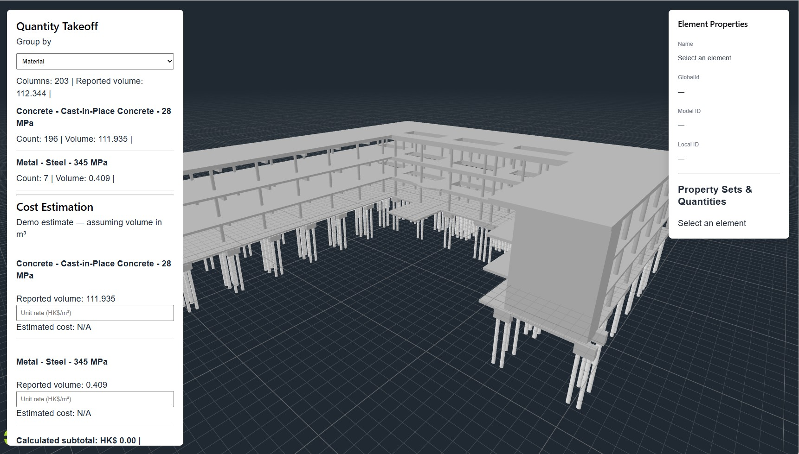
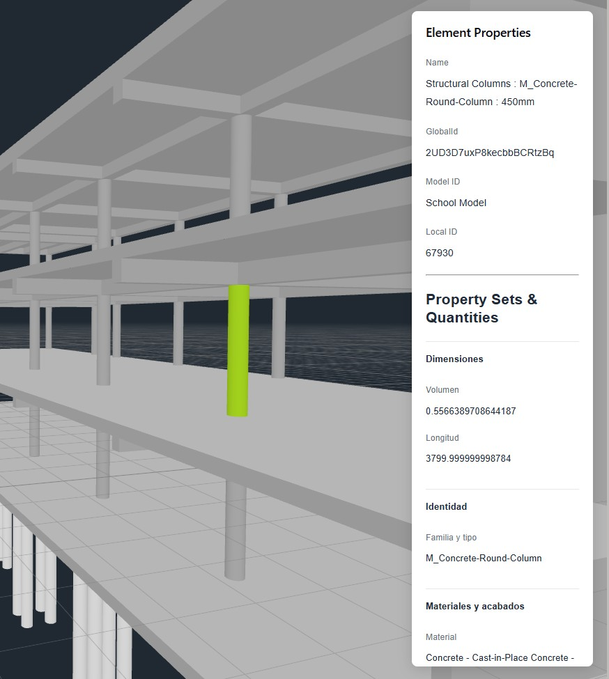
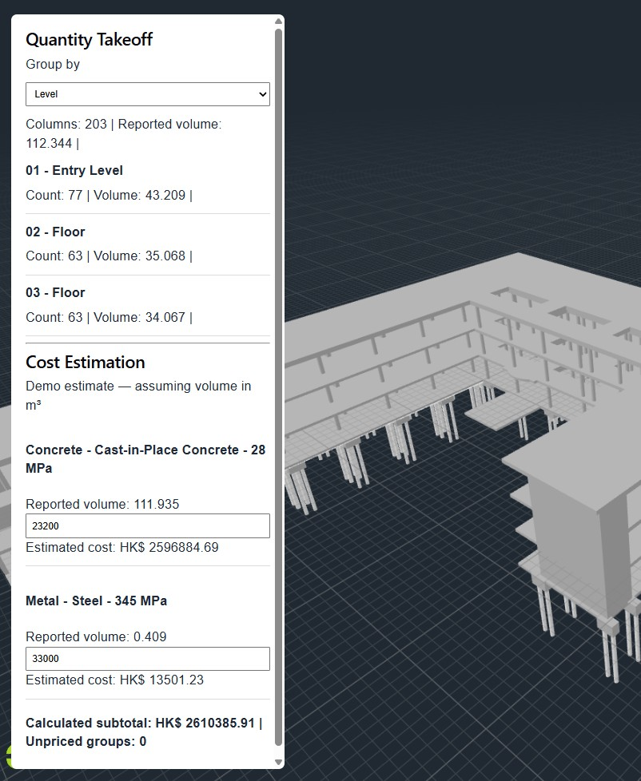
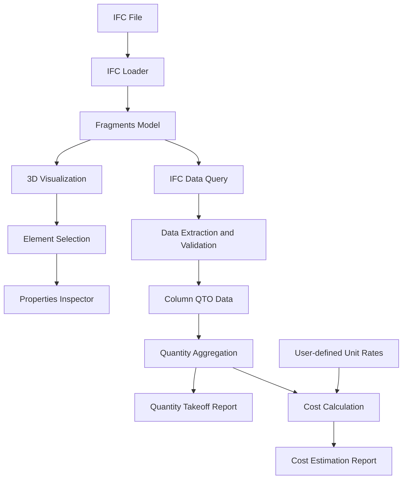

# BIM Viewer & Quantity Takeoff Prototype

A web-based Building Information Modeling (BIM) application for interactive IFC model visualization, property inspection, quantity takeoff (QTO), and preliminary cost estimation.

This project explores how building information can be extracted from IFC models and transformed into structured, actionable data for construction-related workflows.

## Demo

Site: https://bim-qto-viewer.netlify.app/

### 1. Model Visualization

Interactive visualization of the IFC structural model with camera navigation.



### 2. Element Selection and Property Inspection

Select individual building elements to inspect IFC attributes, property sets, materials, and dimensions.



### 3. Quantity Takeoff and Cost Estimation

Automated column quantity aggregation, material-based grouping, and interactive cost estimation using user-defined unit rates.



## Key Features

### 3D Model Visualization

- IFC model loading and visualization
- Interactive camera navigation
- Element selection and highlighting
- Fragments-based model rendering

### BIM Property Inspection

- Element identification using Global IDs and Local IDs
- IFC attribute and relationship querying
- Property Set and Quantity Set inspection
- Display of material, dimensions, and level information where available

### Quantity Takeoff (QTO)

- Automated extraction of structural column data
- Aggregation of model-reported volumes
- Quantity grouping by material, building level, and column type
- Detection of missing or invalid volume values within extracted records

### Cost Estimation

- User-defined material unit rates
- Real-time cost calculation
- Material-based cost breakdown
- Calculated subtotal and unpriced group tracking

## Technology Stack

| Technology           | Purpose                                            |
| -------------------- | -------------------------------------------------- |
| TypeScript           | Application logic and type-safe data processing    |
| Three.js             | 3D rendering                                       |
| That Open Components | BIM viewer and interaction components              |
| That Open Fragments  | Model representation, rendering, and data querying |
| Web-IFC              | IFC parsing                                        |
| Vite                 | Development and build tooling                      |
| HTML / CSS           | User interface                                     |

## Application Architecture



## Technical Highlights

### IFC Data Extraction and Transformation

The application queries IFC attributes and relationships through the Fragments API and transforms nested BIM data into a simplified domain model for quantity and cost analysis.

```typescript
interface ColumnQtoData {
	localId: number;
	globalId: string | null;
	typeName: string | null;
	material: string | null;
	level: string | null;
	volume: number | null;
	length: number | null;
}
```

Property Sets are identified by their names rather than fixed array positions, reducing dependency on the ordering of related IFC entities.

### Quantity Aggregation

Extracted column data is grouped using a reusable aggregation function that supports material, level, and type-based quantity analysis.

Missing quantity values are tracked separately instead of being presented as confirmed zero quantities.

### Asynchronous Selection Handling

A selection version mechanism prevents outdated asynchronous data queries from overwriting the property panel when users rapidly select different building elements.

### Cost Integration

Material-based quantity data is combined with user-defined unit rates to demonstrate a simplified quantity-to-cost workflow.

```
Estimated Cost = Quantity × Unit Rate
```

Cost estimates are recalculated when users modify the unit rates.

## Getting Started

### Prerequisites

- Node.js
- npm

### Installation

```bash
npm install
```

### Run Locally

```bash
npm run dev
```

Open the local URL provided by Vite.

## Current Limitations

- Quantity takeoff currently focuses on structural columns.
- Property extraction is tailored to the Property Set structure of the sample IFC model.
- Extracted volume units and measurement definitions have not been independently verified.
- Cost estimation assumes volumes are expressed in cubic metres and uses user-defined demonstration rates.
- The application does not implement formal construction measurement standards.
- Rendering performance has not been systematically benchmarked.

This project is a technical prototype rather than a production-ready quantity surveying or cost estimation system.

## Future Improvements

- Support additional IFC element categories.
- Support standardized IFC Quantity Sets and configurable property mappings.
- Validate and normalize IFC measurement units.
- Integrate external cost databases.
- Export quantity and cost reports.
- Benchmark and optimize rendering performance for large-scale BIM models.

## Credits

- [That Open Engine](https://github.com/ThatOpen/engine_components)
- [That Open Fragments](https://github.com/ThatOpen/engine_fragment)
- [Three.js](https://threejs.org/)
- [Web-IFC](https://github.com/ThatOpen/engine_web-ifc)

Sample IFC model: `school_str.ifc`, provided through the That Open Components example resources.
